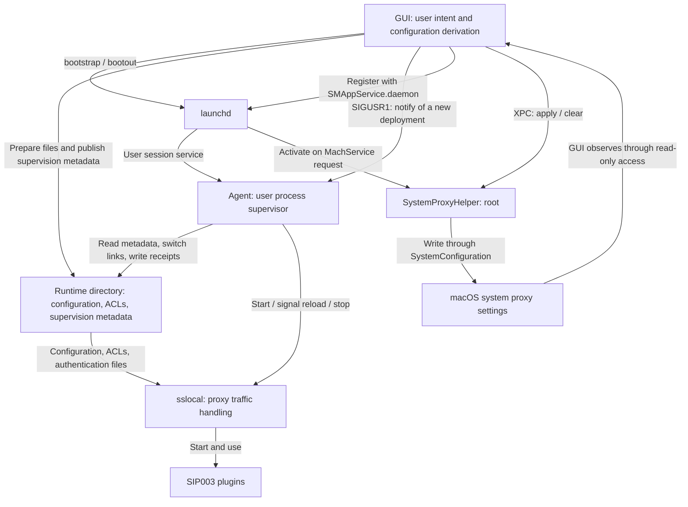
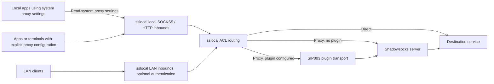

# NG2 process architecture: GUI, Agent, Helper, and sslocal

English | [简体中文](ng2-process-architecture.zh.md)

Implementation snapshot: 2026-10-24. Use the source code for subsequent implementation changes, the [ADRs](../adr/) for accepted designs, and [GLOSSARY.md](../../GLOSSARY.md) for terminology.

The GUI saves user intent, generates runtime configuration, and coordinates system proxy settings. The Agent runs in the user session and starts and supervises sslocal. sslocal accepts proxy requests, routes traffic, and forwards it through Shadowsocks. SystemProxyHelper runs as root and changes macOS system proxy settings at the GUI's request.

## Processes and responsibilities

| Component | Identity and lifecycle | Responsibilities |
| --- | --- | --- |
| GUI: `ShadowsocksX-NG2` | Graphical application running as the current user | Manages the server library, active target, rules, plugins, and listener settings; derives and publishes runtime configuration; decides when to apply, suspend, or clear system proxy settings |
| Agent: `ShadowsocksX-NG2Agent` | LaunchAgent in the current user session, managed by launchd | Reads supervision metadata without secrets, switches stable links, starts, reloads, and stops sslocal, and records deployment receipts and failures |
| Helper: `ShadowsocksX-NG2SystemProxyHelper` | Root LaunchDaemon in the system domain, activated on demand through its MachService | Accepts XPC requests from the GUI and writes or clears system proxy settings through SystemConfiguration |
| `sslocal` | User process started by the Agent | Provides SOCKS5 and HTTP inbounds, reads server configuration and ACLs, and handles direct and proxied traffic |
| SIP003 plugins | Started by sslocal according to server configuration | Provide plugin transport for the corresponding server; executables come from bundled managed plugins or user plugin mappings |

`Domain/` contains shared source compiled into the relevant targets. It has no separate process. The GUI application layer, workflows, and SwiftUI views also run in the same GUI process.

### Control relationships

The GUI and Agent coordinate through files and signals. The GUI and Helper use XPC. The Agent and Helper do not call each other, and the Helper does not start or supervise sslocal.

The production Agent registration implementation writes a manifest with an absolute executable path under `~/Library/LaunchAgents/`, then runs `launchctl bootstrap gui/<uid>`. It uses `bootout` to stop the service. `SMAppService.agent` supplies background item approval status. The Helper is registered through `SMAppService.daemon` using the LaunchDaemon manifest bundled with the application.

## Responsibilities within the GUI

`App/Composition/` assembles dependencies and lifecycle objects. SwiftUI views read facts and submit user actions through workflows such as `CatalogWorkflow`, `ProxyControlWorkflow`, `SettingsWorkflow`, and `RulesWorkflow`.

`ProxyRuntimeController` derives runtime intent from the latest saved configuration catalog, active target, proxy mode, rules, listener configuration, and effective plugin catalog. It then publishes configuration and starts or stops the Agent. `SystemProxyObserver` handles system proxy approval requirements, difference observation, application, repair, and suspension. Both make their decisions in the GUI process.

Shared domain code handles catalog invariants, storage, rule computation, runtime plans, and interprocess contracts. The Agent and Helper compile only the shared files they need. [`project.yml`](../../ShadowsocksX-NG2/project.yml) defines these compilation boundaries.

## From saved configuration to deployment

The persistent server library and the runtime configuration consumed by sslocal have different lifecycles. The library retains the full configuration catalog and credentials. Runtime configuration is derived from the active target and contains only the information needed for that deployment.

### Persistent configuration and secrets

The default application support directory is `~/Library/Application Support/ShadowsocksX-NG2/`:

| Location | Contents and access |
| --- | --- |
| `configuration/catalog.age` | Encrypted server library, read and written by the GUI |
| `configuration/proxy-listening.age` | Encrypted listener configuration, including LAN authentication settings, read and written by the GUI |
| Rule, active target, and plugin data under `configuration/` | Separate configuration files managed by the GUI |
| `runtime/` | Runtime files published by the GUI, plus process identities, receipts, and failure records written by the Agent |
| `logs/agent.log` | Agent events and sslocal logs processed by the output intake |

The server library and listener configuration use separate age identities, with private keys stored in the login keychain. The GUI obtains the plaintext it needs when deriving runtime configuration. sslocal configuration and LAN authentication files currently remain plaintext in the protected runtime directory. Directory permissions are `0700`; regular file permissions are `0600`.

The Agent decodes only `agent-supervision.json`. This contains the deployment identity, generation, listener endpoints, random configuration and authentication identities, file references, and ACL metadata. The Agent does not parse server passwords, plugin arguments, LAN credentials, or private GUI intent metadata. This boundary limits the Agent's processing responsibilities; the Agent and sslocal still run as the same user.

### Publication protocol

1. The GUI builds `SslocalRuntimeDocument` from saved data and outputs sslocal JSON, ACLs, and any required LAN authentication files.
2. Under `runtime.lock`, `RuntimeFileStore` allocates a monotonically increasing generation and writes immutable files named with that generation. Unchanged authentication files and ACLs can be reused.
3. Once all referenced files are prepared and validated, the GUI atomically replaces `agent-supervision.json`. This publishes the deployment intent.
4. On the first run, the GUI registers the Agent. If the Agent is already running, the GUI sends it `SIGUSR1`.
5. The Agent validates the supervision metadata, switches the stable `sslocal-active.json` and `acl-active.ini` links, then starts or reloads sslocal.
6. The Agent writes an `agent-runtime-status.json` receipt. During deployment confirmation, the GUI uses it to check local readiness before coordinating system proxy settings.

The GUI does not decode its sslocal JSON output to recover user intent. It uses the private intent digest, output byte digest, and redacted summary in the same generation's `intent.json` for comparison, integrity checks, and diagnostics. The Agent retains only a reference to this file.

Only the Agent switches stable links. GUI preparation and publication and Agent retirement of old files share `runtime.lock`. The Agent also holds `agent.lock` for its process lifetime to prevent two supervisors from starting listeners concurrently. File retirement preserves references from the latest publication and files still used by the current child process. Stopping the service preserves the generation high-water mark.

### Updates and reloads

`SIGUSR1` from the GUI to the Agent always means "read the new deployment." The Agent then chooses an operation for sslocal according to what changed:

| Change | Agent operation on sslocal |
| --- | --- |
| Server or other configuration bytes change, changing the configuration identity | Switch the configuration link and send `SIGUSR1` |
| ACL changes, including proxy mode or rule changes | Switch the ACL link and send `SIGUSR2` |
| Configuration and ACL change together | Send both signals separately |
| Listener endpoints, IPv6 listener settings, or authentication identity change | Stop the old child and confirm its exit before starting a new process |

Each link is switched atomically on its own, so server configuration and ACL changes can take effect at different times. During initial listener establishment, the Agent accumulates pending reload signals and sends them once the listeners are ready.

A deployment receipt associates `deploymentID` with the sslocal PID and records Agent operations and listener evidence. It does not prove that sslocal successfully parsed and applied a reload. For example, upstream may retain the old rules if ACL parsing fails. There is currently no upstream application acknowledgement protocol.

## Request traffic paths

Local inbounds bind to `127.0.0.1`, with default ports `11086` for SOCKS5 and `11087` for HTTP. LAN inbounds are enabled independently, with default ports `11088` and `11089`. Their settings control address families, authentication, and SOCKS5 UDP relay. Local SOCKS5 supports TCP and UDP. sslocal provides the HTTP inbound directly.

The system SOCKS proxy points to the local SOCKS5 inbound. The HTTP and HTTPS system proxies share the local HTTP inbound; HTTPS requests use its CONNECT support. System proxy settings affect applications that honor them. Explicit proxy configuration can also use the local inbounds directly.

Rule, global, and direct modes are expressed through sslocal ACLs. Global mode retains the fixed local bypass policy. Direct mode keeps the sslocal inbounds running and has sslocal connect directly to destinations. The GUI, Agent, and Helper do not forward normal proxy requests.

The Agent switch and system proxy switch save separate intents. When the service is enabled and system proxy settings are disabled, clients with explicit proxy configuration can still use the local proxy endpoints.

## Helper privileges and system proxy scope

The GUI decides whether to apply system proxy settings. It supplies explicit SOCKS, HTTP, and HTTPS endpoints, PAC and auto-discovery enablement, simple-hostname exclusion, and the complete exceptions list. The Helper decodes typed requests, executes them serially, and returns typed results.

- `apply` handles every network service in the current network location. It changes only managed proxy fields, preserves unmodeled fields, and skips services whose values are already equivalent.
- `clear` removes the complete `Proxies` dictionary from every service in every network location. It does not check the settings' origin or restore another application's previous values.

The GUI observes current settings through read-only SystemConfiguration access. Normal startup and passive network changes primarily check for differences; repairs require an explicit user request. The Helper does not read the server library, obtain Shadowsocks passwords, observe runtime failures, or decide when to clear settings.

The Helper accepts clients whose code-signing identifier is `com.qiuyuzhou.ShadowsocksX-NG2`. It currently places no restriction on Team ID or UID. Each user has independent proxy intent, while system proxy settings are shared across the device. Requests from multiple instances execute serially through the Helper; later writes determine the final values.

## Lifecycle and failure handling

After starting sslocal, the Agent checks that local endpoints accept connections. For regular deployments with an ACL, it also confirms that the TCP listeners belong to that child. If a previously healthy child exits unexpectedly, the Agent replays the current publication. Detectable failures, such as initial readiness failure, link switching failure, or signal delivery failure, produce a persistent failure record associated with the deployment identity and stop that deployment. The Agent does not automatically revert to historical configuration.

launchd restarts the Agent after a nonzero exit under its `KeepAlive.SuccessfulExit = false` policy, with a 2-second throttle configured in the manifest. If the Agent crashes and the recorded old sslocal PID still exists, the next instance refuses to start a second listener process and records a failure.

The GUI confirms readiness during startup, restart, and explicit deployment. During stable operation, while system proxy intent is enabled, it checks for an explicit failure record for the current deployment every 5 seconds. A recorded failure suspends system proxy settings while preserving enabled intent, pending an explicit retry or new runtime intent. Brief receipt gaps during automatic restart, PID changes, or remote connectivity fluctuations do not independently trigger suspension. Absence of a failure record does not prove health. The GUI no longer periodically connects to local ports to detect failures.

When the user turns off the proxy service, the GUI disables system proxy intent and requests cleanup before stopping the background service. On a stop signal, the Agent terminates sslocal, escalating to forced termination if needed. The GUI cleans runtime files only after confirming that the Agent has exited. Helper registration can remain in place for future requests.

When the GUI quits, its termination flow waits for connectivity tests to finish and clean up. The background Agent and normal proxy service continue running, and system proxy settings remain in place. The GUI's failure checks and system proxy suspension logic stop with it; the Helper does not take over these responsibilities. The GUI login item controls whether the graphical application opens at login and is independent of the Agent switch.

### Separate connectivity test processes

For server connectivity tests, the GUI's `ConnectivityRuntime` starts a temporary sslocal directly, using a separate temporary directory and a dynamically allocated loopback HTTP port. The test configuration contains only the server under test and no regular runtime ACL. Requests reach the test URL through that server. Completion or cancellation cleans up the process group and temporary directory.

The test process therefore bypasses the regular Agent, leaves system proxy settings untouched, and does not use regular listener ports. A successful test describes the request result from the specified server to the test URL. It has a different meaning from a regular deployment readiness receipt.

## Source entry points and related decisions

| Area | Source entry points |
| --- | --- |
| GUI composition and workflows | [`App/Composition/MainApp.swift`](../../ShadowsocksX-NG2/App/Composition/MainApp.swift), [`App/Application/`](../../ShadowsocksX-NG2/App/Application/) |
| Agent registration and runtime planning | [`LaunchAgentService.swift`](../../ShadowsocksX-NG2/App/Application/Services/LaunchAgentService.swift), [`ProxyRuntimePlan.swift`](../../ShadowsocksX-NG2/Domain/Runtime/ProxyRuntimePlan.swift) |
| Configuration publication and supervision contract | [`RuntimeFileStore.swift`](../../ShadowsocksX-NG2/Domain/Runtime/RuntimeFileStore.swift), [`RuntimeSupervision.swift`](../../ShadowsocksX-NG2/Domain/Runtime/RuntimeSupervision.swift) |
| Agent supervision loop and listener confirmation | [`Agent/main.swift`](../../ShadowsocksX-NG2/Agent/main.swift), [`AgentListening.swift`](../../ShadowsocksX-NG2/Agent/AgentListening.swift) |
| System proxy policy and XPC client | [`SystemProxyObserver.swift`](../../ShadowsocksX-NG2/App/Application/ProxyRuntime/SystemProxyObserver.swift), [`SystemProxyHelperService.swift`](../../ShadowsocksX-NG2/App/Application/Services/SystemProxyHelperService.swift) |
| Helper contract, validation, and writes | [`Domain/SystemProxy/`](../../ShadowsocksX-NG2/Domain/SystemProxy/), [`SystemProxyWriter.swift`](../../ShadowsocksX-NG2/SystemProxyHelper/SystemProxyWriter.swift) |
| Failure observation during stable operation | [`ProxyRuntimeController+Health.swift`](../../ShadowsocksX-NG2/App/Application/ProxyRuntime/ProxyRuntimeController+Health.swift) |
| Independent connectivity tests | [`ConnectivityRuntime.swift`](../../ShadowsocksX-NG2/App/Application/Connectivity/ConnectivityRuntime.swift) |

Related decisions: [privileged Helper](../adr/0020-privileged-system-proxy-writer.md), [system proxy differences and repair](../adr/0022-observe-system-proxy-differences-and-repair.md), [separate supervision metadata and configuration](../adr/0038-separate-agent-supervision-and-sslocal-input.md), [one-way configuration output](../adr/0043-one-way-sslocal-configuration-output.md), [ACL reload by signal](../adr/0048-reload-sslocal-acl-by-signal.md), [Agent ownership of failure observation](../adr/0049-agent-owned-runtime-failure-observation.md), and [age storage for persistent configuration](../adr/0050-age-encrypted-configuration-storage.md).
