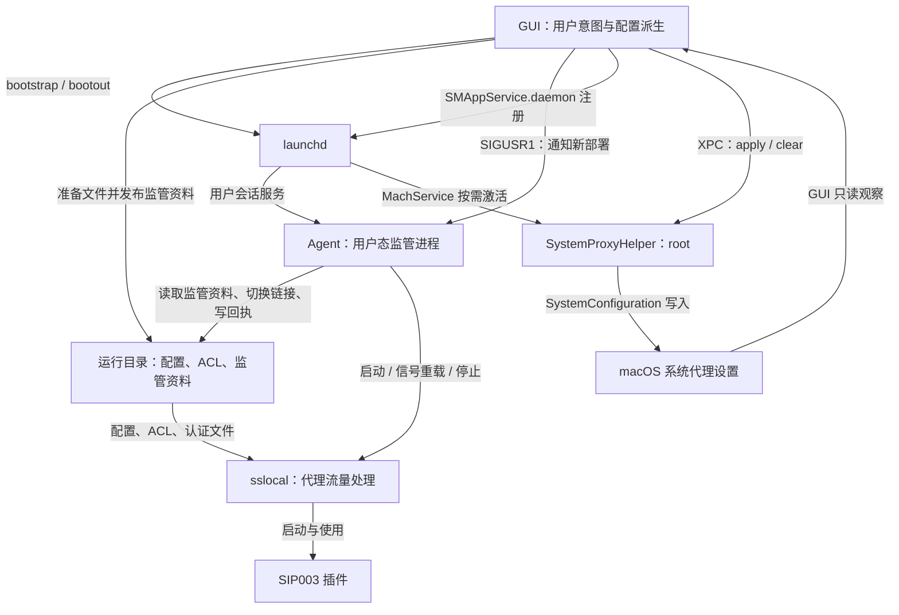
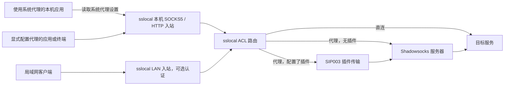

# NG2 进程架构：GUI、Agent、Helper 与 sslocal

[English](ng2-process-architecture.md) | 简体中文

实现快照：2026-10-24。后续实现以源码为准，已接受的设计见 [ADR](../adr/)，术语见 [GLOSSARY.md](../../GLOSSARY.md)。

GUI 保存用户意图、生成运行配置并协调系统代理。用户会话中的 Agent 启动和监管 sslocal；sslocal 接收代理请求，执行路由与 Shadowsocks 转发。具有 root 权限的 SystemProxyHelper 按 GUI 请求修改 macOS 系统代理设置。

## 进程与职责

| 组件 | 运行身份与生命周期 | 职责 |
| --- | --- | --- |
| GUI：`ShadowsocksX-NG2` | 当前用户的图形应用 | 管理服务器库、活动目标、规则、插件与监听设置；派生和发布运行配置；决定何时应用、暂停或清理系统代理 |
| Agent：`ShadowsocksX-NG2Agent` | 当前用户会话的 LaunchAgent，由 launchd 管理 | 读取非秘密监管资料，切换稳定链接，启动、重载和停止 sslocal，记录部署回执与失败 |
| Helper：`ShadowsocksX-NG2SystemProxyHelper` | 系统域 root LaunchDaemon，由 MachService 请求按需激活 | 接受 GUI 的 XPC 请求，通过 SystemConfiguration 写入或清除系统代理设置 |
| `sslocal` | Agent 启动的用户态子进程 | 提供 SOCKS5 与 HTTP 入站，读取服务器配置与 ACL，处理直连和代理流量 |
| SIP003 插件 | 按服务器配置由 sslocal 启动 | 为对应服务器提供插件传输路径；程序可来自随应用发布的托管插件或用户插件映射 |

`Domain/` 是编入相应 target 的共享源码，没有独立进程。GUI 的应用层、工作流和 SwiftUI 视图也都位于同一个 GUI 进程。

### 控制关系

GUI 与 Agent 通过文件和信号协作。GUI 与 Helper 使用 XPC。Agent 和 Helper 之间没有直接调用关系，Helper 也不启动或监管 sslocal。

Agent 的生产注册实现会在 `~/Library/LaunchAgents/` 写入带可执行文件绝对路径的清单，再执行 `launchctl bootstrap gui/<uid>`；停止使用 `bootout`。`SMAppService.agent` 用于读取后台项目批准状态。Helper 则通过 `SMAppService.daemon` 注册应用内的 LaunchDaemon 清单。

## GUI 内部的分工

`App/Composition/` 装配依赖和生命周期对象。SwiftUI 视图通过 `CatalogWorkflow`、`ProxyControlWorkflow`、`SettingsWorkflow`、`RulesWorkflow` 等工作流读取事实、提交用户操作。

`ProxyRuntimeController` 将最新保存的配置目录、活动目标、代理模式、规则、监听配置和有效插件目录派生为运行意图，再执行配置发布和 Agent 启停。`SystemProxyObserver` 负责系统代理的批准门禁、差异观察、应用、修复与暂停。两者的决策都发生在 GUI 进程。

共享领域代码负责目录不变量、存储、规则计算、运行计划和跨进程契约。Agent 和 Helper 只编入各自需要的共享文件；具体编译边界由 [`project.yml`](../../ShadowsocksX-NG2/project.yml) 定义。

## 配置从保存到生效

用户持久保存的服务器库与供 sslocal 使用的运行配置具有不同生命周期。前者保留完整配置目录和凭据；后者由活动目标派生，只包含本次运行所需的信息。

### 持久配置与秘密边界

默认应用支持目录是 `~/Library/Application Support/ShadowsocksX-NG2/`：

| 位置 | 内容与读写方 |
| --- | --- |
| `configuration/catalog.age` | GUI 读写的加密服务器库 |
| `configuration/proxy-listening.age` | GUI 读写的加密监听配置，包含 LAN 认证设置 |
| `configuration/` 下的规则、活动目标和插件资料 | GUI 管理的独立配置文件 |
| `runtime/` | GUI 发布的运行文件，以及 Agent 写入的进程身份、回执和失败记录 |
| `logs/agent.log` | Agent 事件及经过输出 intake 处理的 sslocal 日志 |

服务器库与监听配置分别使用独立的 age identity，私钥保存在登录钥匙串。GUI 在派生运行配置时取得所需明文。当前 sslocal 配置和 LAN 认证文件仍以明文保存于受保护的运行目录，目录权限为 `0700`，普通文件为 `0600`。

Agent 只解码 `agent-supervision.json`，其中包含部署身份、代次、监听端点、随机配置身份与认证身份、文件引用和 ACL 元数据。Agent 不解析服务器密码、插件参数、LAN 凭据或 GUI 私有意图元数据。这个边界限制的是 Agent 的处理职责；Agent 与 sslocal 仍以同一用户身份运行。

### 发布协议

1. GUI 从已保存的资料生成 `SslocalRuntimeDocument`，输出 sslocal JSON、ACL 和必要的 LAN 认证文件。
2. `RuntimeFileStore` 在 `runtime.lock` 内分配单调递增的代次，写入带代次的不可变文件。内容未变的认证文件与 ACL 可以复用。
3. 所有引用文件准备并校验完成后，GUI 原子替换 `agent-supervision.json`。这是部署意图的发布点。
4. 首次运行时，GUI 注册 Agent；Agent 已运行时，GUI 向其发送 `SIGUSR1`。
5. Agent 校验监管资料，切换 `sslocal-active.json` 与 `acl-active.ini` 稳定链接，再启动或重载 sslocal。
6. Agent 写入 `agent-runtime-status.json` 回执，GUI 在部署确认阶段据此检查本地就绪状态，再协调系统代理。

GUI 不会解码已输出的 sslocal JSON 来恢复用户意图。它使用同代 `intent.json` 中的私有意图摘要、输出字节摘要与脱敏汇总完成比较、完整性检查和诊断。Agent 只保留该文件的引用。

稳定链接由 Agent 独占切换。GUI 准备和发布、Agent 回收旧文件共用 `runtime.lock`；Agent 另持有进程期的 `agent.lock`，防止两个监管实例同时启动监听进程。回收会保留最新发布与当前子进程仍使用的文件，停止服务也保留代次高水位。

### 更新与重载

GUI 发给 Agent 的 `SIGUSR1` 统一表示“读取新部署”。Agent 再按变化决定给 sslocal 的操作：

| 变化 | Agent 对 sslocal 的操作 |
| --- | --- |
| 服务器等配置字节变化，配置身份改变 | 切换配置链接，发送 `SIGUSR1` |
| ACL 变化，包括代理模式与规则变化 | 切换 ACL 链接，发送 `SIGUSR2` |
| 配置与 ACL 同时变化 | 分别发送上述两个信号 |
| 监听端点、IPv6 监听设置或认证身份变化 | 停止旧子进程并确认退出，再启动新进程 |

两个链接分别原子切换，服务器配置与 ACL 可以先后生效。Agent 在初次监听尚未就绪时合并待发信号，待就绪后发送。

部署回执关联 `deploymentID` 和 sslocal PID，记录 Agent 操作及监听证据。它不能证明 sslocal 已成功解析和应用热重载内容；例如 ACL 解析失败时，上游可能继续使用旧规则。当前没有上游应用确认协议。

## 请求流量经过哪里

本机入站绑定 `127.0.0.1`，默认 SOCKS5 端口为 `11086`，HTTP 端口为 `11087`。LAN 入站独立启用，默认端口分别为 `11088` 和 `11089`，可选择地址族、认证与 SOCKS5 UDP 中继设置。本机 SOCKS5 支持 TCP 与 UDP；HTTP 入站由 sslocal 直接提供。

系统 SOCKS 代理指向本机 SOCKS5 入站，HTTP 和 HTTPS 系统代理共用本机 HTTP 入站。HTTPS 请求使用该 HTTP 代理的 CONNECT 能力。系统代理设置影响遵循这些设置的应用；显式代理配置也可以直接使用本地入站。

规则、全局和直连模式通过 sslocal ACL 表达。全局模式仍包含固定本地绕过策略；直连模式仍保留 sslocal 入站，由 sslocal 直接连接目标。GUI、Agent 和 Helper 均不转发正常代理请求。

代理服务开关与系统代理开关分别保存意图。服务开启而系统代理关闭时，本地代理入口仍可供显式配置代理的客户端使用。

## Helper 的权限与系统代理范围

GUI 决定是否应用系统代理，并显式提供 SOCKS、HTTP、HTTPS 端点、PAC 与自动发现启停、简单主机名排除及完整例外列表。Helper 解码类型化请求、串行执行，再返回类型化结果。

- `apply` 处理当前网络位置的所有网络服务，只修改受管代理字段，保留未建模的字段，并跳过值已等价的服务。
- `clear` 移除所有网络位置、所有网络服务的完整 `Proxies` 字典，不判断设置来源，也不恢复其他软件的旧值。

GUI 通过只读 SystemConfiguration 访问观察当前设置。正常启动和被动网络变化以检查差异为主；差异修复由用户明确请求。Helper 不读取服务器库、不获取 Shadowsocks 密码，也不自行观察运行故障或决定清理时机。

Helper 接受代码签名 identifier 为 `com.qiuyuzhou.ShadowsocksX-NG2` 的客户端，当前不限制 Team ID 或 UID。各用户拥有独立代理意图，但系统代理设置是设备级共享状态；多个实例的请求经 Helper 串行执行，后执行的写入决定最终值。

## 生命周期与失败处理

Agent 启动 sslocal 后检查本地端点可连接，并在正式带 ACL 的部署中确认 TCP 监听属于该子进程。已健康子进程意外退出时，Agent 重放当前发布。首次启动未就绪、链接切换或信号投递失败等可检测故障，会形成与部署身份关联的持久失败记录，停止该部署，不自动切回历史配置。

Agent 非零退出时由 launchd 的 `KeepAlive.SuccessfulExit = false` 策略重启，清单配置了 2 秒节流。Agent 崩溃后若记录中的旧 sslocal PID 仍存在，下一实例拒绝启动第二个监听实例，并记录失败。

GUI 在启动、重启和显式部署时执行就绪确认。稳定运行期间，系统代理意图开启时，GUI 每 5 秒检查当前部署的明确失败记录；发现失败后暂停系统代理并保留开启意图，等待显式重试或新运行意图。自动重启中的短暂回执空窗、PID 变化或远端波动不会单独触发暂停。没有失败记录也不能证明服务健康，GUI 不再周期性连接本地端口来判定故障。

关闭代理服务时，GUI 关闭系统代理意图并请求清理，再停止后台服务。Agent 收到停止信号后终止 sslocal，必要时升级为强制终止；GUI 确认 Agent 退出后才清理运行文件。Helper 的注册可以继续保留，供后续按需调用。

退出 GUI 时，退出流程等待连通性测试结束与清理，后台 Agent 和正常代理服务继续运行，系统代理设置保留。此时 GUI 中的故障检查和系统代理暂停逻辑也随之停止；Helper 不接管这些职责。GUI 登录项只控制是否在登录时打开图形应用，与代理服务开关独立。

### 连通性测试的独立进程

服务器连通性测试由 GUI 的 `ConnectivityRuntime` 直接启动临时 sslocal，使用独立临时目录和动态分配的回环 HTTP 端口。测试配置只含待测服务器，不带正式运行 ACL，请求通过该服务器访问测试 URL。测试完成或取消后清理进程组与临时目录。

因此，测试进程不经过正式 Agent，也不修改系统代理或占用正式监听端口。测试成功描述指定服务器到测试 URL 的请求结果，与正式部署的就绪回执具有不同含义。

## 源码入口与相关决定

| 关注点 | 源码入口 |
| --- | --- |
| GUI 装配与工作流 | [`App/Composition/MainApp.swift`](../../ShadowsocksX-NG2/App/Composition/MainApp.swift)、[`App/Application/`](../../ShadowsocksX-NG2/App/Application/) |
| Agent 注册与运行计划 | [`LaunchAgentService.swift`](../../ShadowsocksX-NG2/App/Application/Services/LaunchAgentService.swift)、[`ProxyRuntimePlan.swift`](../../ShadowsocksX-NG2/Domain/Runtime/ProxyRuntimePlan.swift) |
| 配置发布与监管契约 | [`RuntimeFileStore.swift`](../../ShadowsocksX-NG2/Domain/Runtime/RuntimeFileStore.swift)、[`RuntimeSupervision.swift`](../../ShadowsocksX-NG2/Domain/Runtime/RuntimeSupervision.swift) |
| Agent 主循环与监听确认 | [`Agent/main.swift`](../../ShadowsocksX-NG2/Agent/main.swift)、[`AgentListening.swift`](../../ShadowsocksX-NG2/Agent/AgentListening.swift) |
| 系统代理策略与 XPC 客户端 | [`SystemProxyObserver.swift`](../../ShadowsocksX-NG2/App/Application/ProxyRuntime/SystemProxyObserver.swift)、[`SystemProxyHelperService.swift`](../../ShadowsocksX-NG2/App/Application/Services/SystemProxyHelperService.swift) |
| Helper 契约、校验与写入 | [`Domain/SystemProxy/`](../../ShadowsocksX-NG2/Domain/SystemProxy/)、[`SystemProxyWriter.swift`](../../ShadowsocksX-NG2/SystemProxyHelper/SystemProxyWriter.swift) |
| 稳定期失败观察 | [`ProxyRuntimeController+Health.swift`](../../ShadowsocksX-NG2/App/Application/ProxyRuntime/ProxyRuntimeController+Health.swift) |
| 独立连通性测试 | [`ConnectivityRuntime.swift`](../../ShadowsocksX-NG2/App/Application/Connectivity/ConnectivityRuntime.swift) |

相关设计依据：[特权 Helper](../adr/0020-privileged-system-proxy-writer.md)、[系统代理差异与修复](../adr/0022-observe-system-proxy-differences-and-repair.md)、[监管与配置分离](../adr/0038-separate-agent-supervision-and-sslocal-input.md)、[配置单向输出](../adr/0043-one-way-sslocal-configuration-output.md)、[ACL 信号重载](../adr/0048-reload-sslocal-acl-by-signal.md)、[Agent 故障观察职责](../adr/0049-agent-owned-runtime-failure-observation.md)、[age 持久配置](../adr/0050-age-encrypted-configuration-storage.md)。
